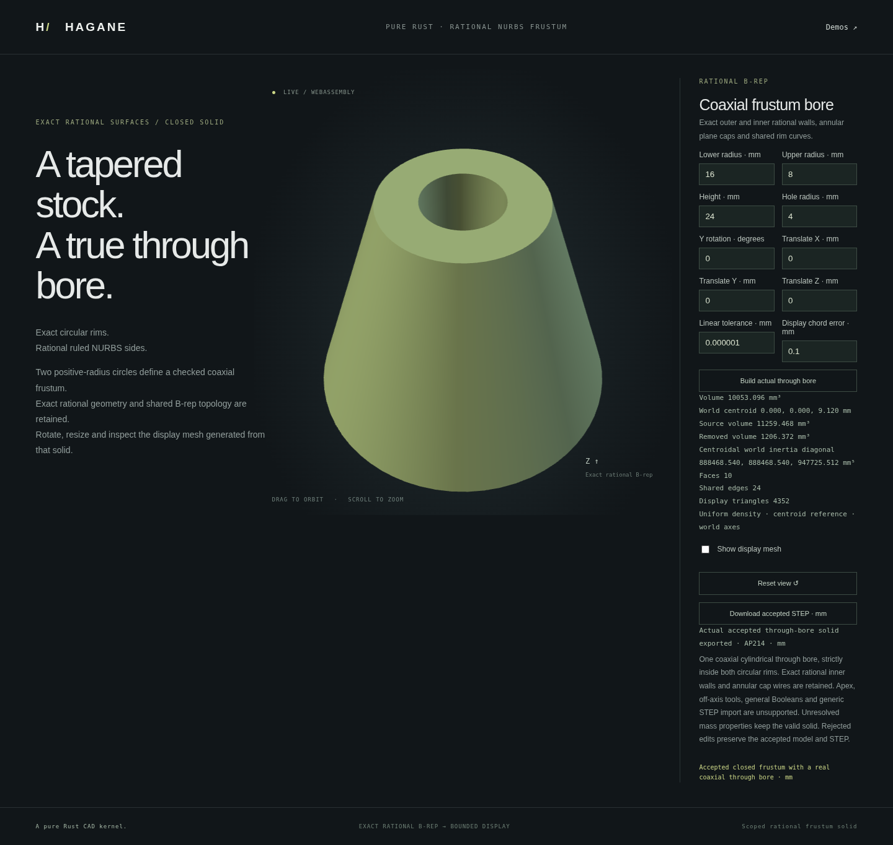

# Coaxial through bores in rational frusta

`NurbsFrustumSolid::bore_coaxial(radius, policy)` returns an actual closed
`NurbsBoredFrustumSolid`. This supported difference removes a finite coaxial
cylinder through the source's full cap interval. It preserves the source's
exact outer geometry and introduces four inward rational cylindrical wall
patches plus inner circular wires on both planar caps. There is no mesh CSG.

```rust
use hagane::*;
# fn example() -> Result<()> {
let policy = GeometryTolerance::new(1e-6, 1e-10, 0.)?;
let stock = NurbsFrustumSolid::new(Frame3::IDENTITY, [16., 8.], 24., policy)?;
let part = stock.bore_coaxial(4., policy)?;
part.validate(policy)?;
let mesh = part.tessellate(0.1, policy)?;
let step = part.export_step_mm(policy)?;
assert!(!mesh.triangles.is_empty());
assert!(step.contains("CLOSED_SHELL"));
# Ok(()) }
```

## Retained geometry and supported domain

The actual kept B-rep has sixteen vertices, twenty-four shared edges and ten
oriented faces. Both caps have outer and inner wires. Four original rational
outer walls remain unchanged; four exact tool-cylinder walls face the cavity.
Spatial circle curves and same-parameter rational pcurves remain explicit.
The shell has genus one; counting annular faces as disks would give the wrong
Euler characteristic.

The tool uses the source's rigid frame, equal radii and full height. The initial
operation requires a resolved positive hole and positive wall clearance at
both caps. Touching, oversized or unresolved radii reject explicitly. Off-axis,
blind, intersecting and repeated bores on the new type remain unsupported,
as do general frustum Booleans and bored-frustum STEP import. Exact STEP export
serializes the kept surfaces, curves and both cap loops.

The radius and smallest cap wall gap must exceed ten source length bands plus
the arithmetic allowance. The length band uses the source extent
`hypot(2*max(R0,R1), H)` and the caller's absolute/relative policy, rather than
the query or hole size. World-coordinate precision must also resolve the
linear tolerance. The privately retained construction certificate checks
actual geometry, whole cap-curve attachment and opposed shared-edge incidence.

## Volume and moments

For source radii R0, R1, height H and hole radius r, the mathematical volume is
`π H (R0² + R0 R1 + R1² − 3r²)/3`. The implementation instead uses positive
factored terms with d0=R0−r, d1=R1−r:

```
V = π H [d0*(R0+r+R1) + d1*(R1+2r)] / 3
```

This avoids subtracting almost equal stock and tool volumes. Analytic centroid
and centroidal inertia use normalized positive Bernstein coefficients of the
annular disk area and fourth radial moments. World tensors are rotated from
the local centroidal frame. Unresolved arithmetic or overflow/underflow returns
an explicit metric error rather than a sampled fallback or a fabricated tensor.
With millimetre coordinates and density one, volume is mm³ and inertia mm⁵.

## Display and demo

The display mesh comes from the actual retained boundary. Annular cap strips
connect outer and inner circle samples; no center fan fills the hole. Shared
rim and generator samples preserve closure, and inward wall normals face the
cavity. Rational Bernstein bounds and arithmetic allowances control admitted
chord error; excessive refinement fails explicitly.
The common grid is limited to 64 cells per axis, or 66,560 triangles overall.

Run `cargo run --locked --example nurbs_frustum_bore`. Optional JSON input has
ten finite values: lower radius, upper radius, height, Y rotation in radians,
translation XYZ, linear tolerance, chord tolerance and hole radius. Reports
include actual kept geometry, source/tool volumes and checked mass availability.

Build with `./scripts/build-web.sh`, serve `web`, and open
`/nurbs-frustum-bore.html` to edit the hollow part, orbit/zoom and export STEP.
Rejected edits preserve the accepted solid, camera and export.

Independent tests compare positive cylindrical-coordinate integration and
annular-cylinder formulas, all world tensor entries and source/tool moment
conservation. They verify exact source geometry prefixes, oriented edge sharing,
annular cap loops, scales, poses and thin-wall precision. Display checks verify
exact shared samples, genus-one closure, inward normals, actual-patch chord
bounds and an open cavity. Native/WASM/browser checks compare actual reports
and STEP and preserve the accepted state after invalid or unresolved requests.



The circular rational construction, Bernstein integration of polynomial
annular sections and tensor rotation are public mathematics. This original
MIT OR Apache-2.0 implementation uses no OCCT source or new dependencies.
See [references and dependency licenses](references.md).

## Mesh-free point classification

`part.classify_point(point, policy)` returns `Inside`, `Outside` or `Boundary`
for the actual retained solid. In the source meridian plane it computes the
Euclidean distance to the finite outer generatrix, finite inner cylinder and
both annular cap intervals. This includes diagonal distances to circular rims;
independent wall/cap tolerance bands are not substituted for rim distance.
Queries in the hole and beyond cap extensions are outside. The source extent
sets the relative tolerance, and source frame/world arithmetic is checked before
shortcuts. Unresolved threshold comparisons return `Unsupported`.

The [editable workflow](nurbs-frustum-workflow.md) adds `coaxial_bore` to schema 1.
It retains the actual bored component for radius edits, selection, Undo/Redo,
bounded display and exact STEP output. A canonical single component is required;
axial partitions and complete interior plane cuts retain the actual hole
in every child. Repeated bores and further cuts of oblique children remain
explicit errors.

## Exact finite segment intersections

`part.intersect_segment(start, end, policy)` returns checked hits and
`material_intervals`, with parameters on the original segment from 0 to 1.
A line crossing both sides of the hole has four boundary hits and two material
intervals. Each hit carries the actual kept B-rep face IDs and surface UVs;
tool cap faces are not part of the result.

The implementation subtracts the actual finite tool cylinder's checked convex
interval from the source's checked convex interval. It validates each retained
material midpoint and its endpoints against the actual bored solid and verifies
retained surface witnesses. The tool uses the source's effective length band
while retaining the caller's absolute arithmetic budget. No mesh intersection
or modeling cut determines these intervals.

For radii `[16,8]`, height 24 and hole radius 4, the segment from `[-20,0,12]`
to `[20,0,12]` has hits at `0.2, 0.4, 0.6, 0.8` and material intervals
`[0.2,0.4]`, `[0.6,0.8]`. A segment along the axis through the hole has no
material intervals. Segments contained in material retain `[0,1]`.

The initial domain inherits conservative convex-query admission: tangencies,
rim contacts, endpoints within the source/tool boundary bands, unresolved
crossing order, tiny material intervals and insufficient world precision reject
explicitly. In particular, an endpoint on a removed cap disk may still reject
through source-query admission even when it is outside the bored solid.
A guarded convexity certificate directly returns empty material when both
radial endpoints are strictly inside the hole; this avoids merging nearly
coincident source/tool cap roots. Original endpoint precision checks still run.
[Retained line/ray queries](nurbs-frustum-retained-line.md) are supported;
[oblique-child finite segment queries](nurbs-frustum-oblique-segment.md) are
supported separately. The [workflow](nurbs-frustum-workflow.md) provides a read-only browser probe.

[Axial bore partitions](nurbs-frustum-bore-partition.md) produce closed annular
children and support continued editing after explicit component selection.

[Oblique plane cuts](nurbs-frustum-bored-oblique.md) preserve the actual bore
through two closed annular children and exact STEP export.
