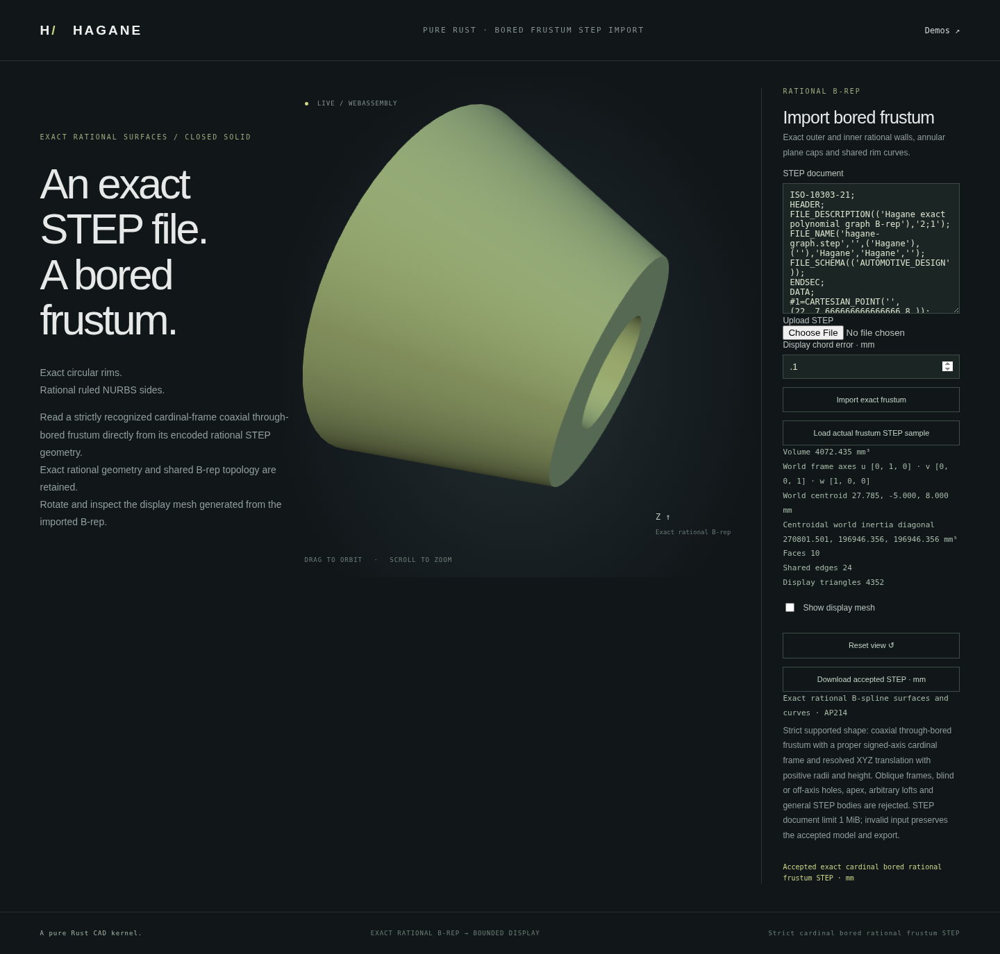

# Exact cardinal-frame bored frustum STEP import



`import_step_nurbs_bored_frustum_cardinal_mm(text, policy)` reads one exact
canonical rational frustum with a coaxial cylindrical through hole. The bounded
representation has 16 vertices, 24 shared edges, eight rational walls and two
planar caps, each with an outer and inner wire. Units are millimetres; translated
right-handed signed-cardinal frames are supported. Arbitrary rotations,
oblique children, multiple holes, other units and general STEP remain unsupported.

```rust
use hagane::*;
# fn example(text: &str) -> Result<()> {
let policy = GeometryTolerance::default();
let body = import_step_nurbs_bored_frustum_cardinal_mm(text, policy)?;
let mesh = body.tessellate(0.1, policy)?;
let step = body.export_step_mm(policy)?;
# Ok(()) }
```

The decoder retains actual rational curves, surfaces and pcurves. A complete
canonical construction is only a checking witness: every vertex, edge, face
and both cap wires must map bijectively onto it. Inner walls and cap wires must
have the required cavity orientation. Cyclic wire starts and STEP record IDs
are not modeling parameters. Analytic LINE/VECTOR and affine UV representatives
are restored only after exact serialized-preimage checks. No tolerance fitting,
weight normalization or substitute reconstructed body is returned.

The retained B-rep supplies tessellation, annular classification, volume,
centroid, inertia and re-export. As with the cardinal hole-free importer,
construction parameter bits may be lost in represented translated cap separation;
retained geometry is exact, while recovered metrics can differ by rounding.
Insufficient precision or a changed coefficient returns an explicit error.
The existing hole-free and generic analytic importer domains remain unchanged.

The separate demo uses an actual exported X-oriented translated upper axial
child with a through hole. Its local height is 14 mm, world origin
`[22,-5,8]`, axes `[Y,Z,X]` and volume approximately 4072.435 mm³. Run:

```sh
cargo run --example nurbs_frustum_bored_step_import_demo
./scripts/build-web.sh
python3 -m http.server 8000 --directory web
# Open /nurbs-frustum-bored-step-import.html.
```

The shared bounded parser permits at most 1 MiB; byte transport limits input to
2 MiB and rejects invalid UTF-8. Rejected imports retain accepted geometry,
camera and STEP. Native and WASM use the same Rust import certificate.

Original code is MIT OR Apache-2.0. This extends Hagane's independent complete
rational coefficient/topology and serialized-preimage certificates. No external
implementation, OCCT source or new dependency is used.
