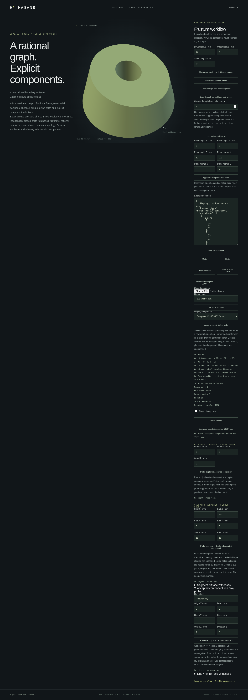
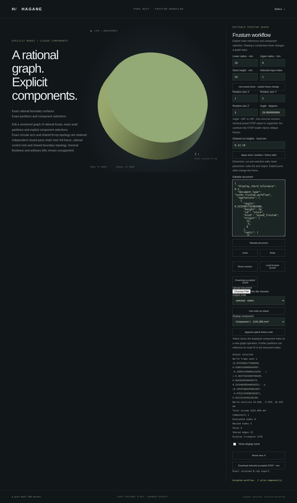

# Editable rational frustum workflow

The versioned Rust workflow connects exact cardinal-frame frustum construction,
axis-angle poses, actual STEP input, axial partitions, closed oblique plane splits,
coaxial through bores and explicit component selection. A session
retains unchanged B-rep prefixes, reports real node evaluation counts and
supports bounded Undo/Redo. It is a scoped modeling graph, not a general CAD
history or Boolean engine.

```rust
use hagane::*;
# fn example() -> Result<()> {
let document = nurbs_frustum_workflow_example_document()?;
let mut session = NurbsFrustumWorkflowSession::new();
let command = serde_json::json!({"command":"rebuild","document":document});
let report = nurbs_frustum_workflow_session_command_json(
    &mut session, &command.to_string(),
)?;
# Ok(()) }
```

Run `cargo run --example nurbs_frustum_workflow` for the actual default report.
The [example document](nurbs-frustum-workflow-example.json) is the actual default graph.
The example also accepts one JSON command or a JSON array of commands; the
array shares one session and can demonstrate incremental edits and Undo/Redo.

## Document and operations

Schema 1 uses `document_type: "nurbs_frustum_workflow"`, mm units, explicit
linear/angular/relative tolerances, a display chord tolerance, an output node ID
and an ordered list of operations. Unknown fields, duplicate IDs, unavailable
outputs and forward references are rejected.

| Kind | Result and restrictions |
| --- | --- |
| `frustum` | One exact positive-radius frustum from radii, height, origin and three axes. Axes must be one of the 24 exact right-handed signed coordinate bases. |
| `posed_frustum` | One actual frustum from positive radii/height, origin, a nonzero finite `rotation_axis` and `angle` in [-π, π] radians. Uses checked rigid rotation; no scale, shear or reflection. |
| `step_stock` | One actual body from the checked [cardinal STEP importer](nurbs-frustum-cardinal-step-import.md), retaining rational geometry and UV boundaries. |
| `partition` | All actual closed parts from 1–16 ordered source-local physical cut heights. Input must contain exactly one canonical or bored component. |
| `plane_split` | Two actual closed oblique children from world `origin` and `normal`. Requires one canonical or bored component; the complete cut must stay strictly between its original caps. Lower/upper ordering is independent of normal sign. |
| `coaxial_bore` | One actual genus-one rational body with a coaxial through hole. Requires one canonical component and resolved positive radius/wall clearance. |
| `select` | The explicitly indexed component of an earlier node, shared as the actual typed body. |

The default graph constructs an X-oriented 16-to-8 mm frustum of height 24 mm,
cuts at local heights 6, 12 and 18 mm and selects component 1. Setting the output
to the partition node returns all four parts, each with its own display report
and exact STEP. Further partitioning a multi-part output requires an explicit
`select` node; no largest-component heuristic is used.

## Transactions and bounds

The command protocol supports `rebuild { document }`, `undo`, `redo` and
`reset`. Successful reports contain the accepted document, all output
components, individual STEP strings, output status, cache counters and history
availability. Domain failures return `ok: false` with an operation diagnostic
and the last accepted document. Malformed transport returns an explicit error.

Geometry, display and report validation finish before the accepted document,
cache or history changes. Output-only and display-only edits reuse geometric
prefixes; tolerance changes invalidate the cache. Rejected edits and failed
Undo/Redo callbacks retain the accepted state. Undo/Redo retain at most 32
document states in each direction; accepting a new edit clears Redo.

There are at most 16 operations and 17 components per partition. Default session
acceptance and the shared demo enforce 131,072 display triangles across the
complete output; custom `rebuild_with` callbacks control output validation. STEP sources are individually bounded to
1 MiB, with a combined 2 MiB source budget. JSON/byte commands are bounded to
2 MiB. The WASM byte input rejects invalid bytes, malformed UTF-8 and overflow;
begin/finish resets the transport latch without silently resetting the session.

The native and WASM command paths share the kernel, actual-body serializer and
transaction rules. Arbitrary-angle STEP import, apex shapes, general lofts,
skew planes in the parallel-cut API and general frustum Booleans are unsupported.
Axial `partition` on an oblique child is also explicitly unsupported.
Canonical and bored components support checked axial partitions.

## Oblique children and Rust API migration

The [oblique example document](nurbs-frustum-workflow-oblique-example.json)
constructs an identity-frame source and retains both actual closed children.
Select component 0 or 1 with the existing `select` node to retain the lower or
upper child and export its actual STEP. Plane edits reuse the unchanged source
prefix; output/display edits reuse the actual children.

For Rust 0.1 callers, `components()` now returns typed
`NurbsFrustumWorkflowComponent` values rather than only canonical frustum Arcs.
Use unified geometry/volume/display/export methods, or explicitly inspect
`canonical()` / `oblique()` / `bored()` for type-specific operations. This is a source API
change: canonical-only callers must unwrap the canonical variant. An oblique
child is never replaced by its source frustum or silently returned as empty.
Match `BoredOblique` for the new annular slanted child type. Its analytic mass
and inertia have checked availability; finite mesh-free point queries are supported.
Unresolved metrics leave geometry, display and export available.
Existing valid JSON documents and canonical report fields remain supported.

Oblique components report actual `mass_properties` with checked availability.
A metric-only `Unsupported` result leaves geometry, volume, mesh and STEP usable;
other errors still reject the output before session commit. No source centroid
or tensor is substituted for an unavailable child metric.

## Coaxial bore histories

The [through-bore example](nurbs-frustum-workflow-bore-example.json) connects
stock to an actual cylindrical difference with radius 4 mm. Radius edits reuse
the stock prefix and rebuild the real annular boundary. Undo/Redo and explicit
selection retain the actual bored body; each accepted component exports its own
STEP. [Axial partitions](nurbs-frustum-bore-partition.md) retain the actual hole
in every child; Select permits further local axial partitions.
[Oblique plane cuts](nurbs-frustum-bored-oblique.md) retain annular children.
[Repeated parallel cuts](nurbs-frustum-parallel-slabs.md) now retain typed slabs
after explicit selection. Skew planes in the parallel-cut API and general
repeated boring still reject explicitly.
The stock can still be selected as a separate earlier output node.

Typed components dispatch point queries to the corresponding finite body,
including the canonical bored solid's actual inner wall and annular cap distances.
[Bored-oblique point queries](nurbs-frustum-bored-oblique-classify.md) use finite
annular cut-cap witnesses;
[finite segment queries](nurbs-frustum-bored-oblique-segment.md) retain both
material intervals. Their line/ray queries also preserve original parameters.
The source's filled cap disks are not substituted for annular boundaries.

## Read-only point queries

`session.classify_point(component, point)` classifies one explicitly indexed
component of the accepted output, using the accepted document's tolerance.
It reads the retained actual B-rep; it does not replay nodes, create display
meshes, replace cached shapes or change Undo/Redo history.

The native/WASM JSON command is:

```json
{"command":"query","component":0,"point":[6,0,12]}
```

Successful responses contain `query.component`, `query.point`, lowercase
`query.location` (`inside`, `outside`, `boundary`) and `query.mesh_free: true`,
with `units: "mm"`. They omit the model report and its mesh/STEP payloads.
Missing accepted models, unavailable indices, malformed input and unresolved
arithmetic return explicit errors while preserving the accepted model/history.
Oblique cut-rim ambiguity keeps the classifier's explicit unsupported
result; this command does not relax geometric admission.

The browser's separate world-coordinate point probe queries the accepted
selected component even when the JSON editor contains a rejected draft.
Successful or failed probes preserve rendering, camera and STEP export.
A failed probe preserves the last successful result; accepting another model
or changing displayed components clears it to avoid stale labels.

## Read-only segment queries

```json
{"command":"segment","component":0,"start":[-20,0,12],"end":[20,0,12]}
```

The command queries the accepted output component with its document tolerance.
Success contains `segment.start`, `segment.end`, `segment.component`, actual
`segment.hits` (parameter, world point and face/UV witnesses),
`segment.material_intervals` and `segment.mesh_free: true`, with mm units.
Canonical and [oblique components](nurbs-frustum-oblique-segment.md) support
one optional material interval; bored components support zero, one or two.
Oblique hits refer to the actual cut cap and restricted rational walls.

The browser offers a separate world-coordinate segment probe. It displays
intersection and material interval results while preserving geometry, point
probe, camera, STEP and history. Failed requests keep the last successful
segment result. Accepted geometry or displayed component changes clear it.
The same explicit contact and arithmetic restrictions as the typed
[finite bore query](nurbs-frustum-bore.md) apply.

## Read-only line and ray queries

```json
{"command":"ray","component":0,"origin":[0,0,12],"direction":[2,0,0]}
```

Use `command: "line"` for the unbounded line. Both accept an explicit output
component and return a small `line` report with `kind`, `origin`, `direction`,
`component`, actual `hits`, `material_intervals` and `mesh_free: true`, with mm
units. Parameters refer to the original nonunit direction. Rays clip to t >= 0;
canonical/oblique components have at most one interval, bored components at most
two. These commands use the accepted tolerance and actual typed B-rep, never a
mesh or the source substitute. The [retained line/ray contracts](nurbs-frustum-retained-line.md)
document precision, contact, boundary-origin and finite-query restrictions.

The separate browser probe preserves geometry, camera, STEP, history and the
point/segment results. Failed requests keep the last successful line/ray result;
accepted model or displayed component changes clear it.

## Browser editing

Run `./scripts/build-web.sh`, then `python3 -m http.server 8000 --directory web`
and open `/nurbs-frustum-workflow.html`. The dedicated page edits the same
versioned document and supports Undo/Redo, JSON upload/download and exact STEP
export for each accepted output component.

The default three-node graph has radius, height, cut-height and component-index
controls. The oblique preset uses the actual `plane_split` node and adds world
plane origin/normal controls; its two components are the actual closed children. These preserve node IDs and
the exact stock frame. The through-bore preset adds hole-radius controls for the
actual `coaxial_bore` node. The bore-partition preset connects this hole to
four actual annular parts and exposes cut-height controls. The bored-oblique
preset exposes both the hole radius and the world plane for two slanted annular
children. Controls irrelevant to the current operation stay hidden. Other histories,
including STEP stocks and additional nodes, use the JSON editor; simplified
controls are disabled. Choosing a displayed component does not change the graph.
The explicit Select button appends a real operation. Setting another output
node reuses the accepted geometric prefixes.

A rejected edit leaves the accepted report, rendering, camera, export and kernel
history intact; the JSON editor retains the attempted document. Reset clears
the session, display and exports. A downloaded JSON document can be reloaded
and rebuilt in a new session; Undo/Redo history is session-local.



## Verification and provenance

Tests compare fresh and incremental actual B-reps, rational control nets, STEP
input and re-export, analytic volume/first-moment conservation and opposed
partition seams. They check real `Arc` reuse, explicit selection, invalid graph
and tolerance failures, callback rollback, output/display cache reuse, history
bounds and Redo invalidation. Demo checks compare complete actual component
reports and reject display work beyond the aggregate budget before committing.
Oblique tests additionally compare direct child geometry, selected Arc identity,
plane-edit prefix reuse, exact child export and unsupported skew-recut rollback.
Near-uniform taper may refuse only moments while preserving the accepted shape.
The workflow reuses this repository's original kernel and transaction design;
no dependencies or OCCT source were added. Code is MIT OR Apache-2.0.

## Axis-angle stock placement

Run `cargo run --example nurbs_frustum_workflow_pose` for the actual posed
workflow report. Its [document](nurbs-frustum-workflow-pose-example.json) uses
axis `[1, 2, 3]`, angle `0.37` radians and world origin `[12, -5, 8]` mm.
The axis direction is normalized with overflow-safe vector normalization. The
frame is a checked right-handed orthonormal basis; reports retain its actual
three axes rather than a guessed Euler angle. Local points map to `R*p + origin`:
the origin is placed after rotation and remains the supplied world point.

In the browser, **Use posed stock** explicitly replaces the cardinal stock axes
with the new axis-angle recipe and preserves dimensions, origin and node IDs.
The pose controls display degrees; the document stores radians. Dimension and
cut edits preserve an unchanged accepted angle without a unit-conversion
round trip. Advanced histories still use the JSON editor.

Partitions use physical source-local axial distances in this frame. Their
closed children retain actual posed rational curves, ruled surfaces and pcurves.
Native/WASM tests independently check Rodrigues rotation, world centroids and
full matrix inertia; rejected pose edits preserve the accepted graph/history.

This new node preserves the old `frustum` node's 24 exact signed coordinate bases.
STEP export remains actual B-rep; the cardinal STEP importer still rejects
general oblique frames. A posed document can be saved and rebuilt without
claiming general rotated STEP import.



The separate [retained-bore operation](nurbs-frustum-retained-bore.md) allows
`coaxial_bore` on one plain `PlaneBounded` component and
`enlarge_coaxial_bore` on one `BoredPlaneBounded` component. These use actual
retained section planes and keep the outer body. Older canonical, single-cut
oblique and parallel-slab bore domains remain unchanged.
