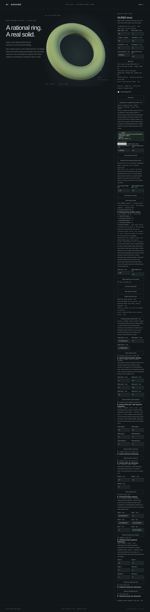

# Exact horizontal torus sections



`NurbsTorusSolid::section_by_local_z(height, policy)` returns a typed intersection
boundary of the actual regular ring-torus B-rep and a plane perpendicular to its
represented axis. Height uses the source frame's local Z and model length units.
Rigidly rotated and translated sources use the same API.

```rust
use hagane::{Frame3, GeometryTolerance, NurbsTorusSolid};

fn main() -> hagane::Result<()> {
    let policy = GeometryTolerance::new(1e-6, 1e-10, 0.0)?;
    let torus = NurbsTorusSolid::new(Frame3::IDENTITY, [16.0, 4.0], policy)?;
    let section = torus.section_by_local_z(1.0, policy)?;
    section.validate(policy)?;
    println!("{} loops, {} exact edges", section.loops().len(), section.edges().len());
    Ok(())
}
```

The result contains two closed four-edge loops, eight shared vertices, quadratic
rational spatial curves, plane pcurves and original source-face parameter
attachments. The outer loop precedes the inner loop. Both traverse increasing
source major parameter; these are intersection loops, not the oppositely oriented
wires of an annular face. No solid, Boolean result or display mesh substitutes
for the intersection geometry.

Spatial curves and plane pcurves are retained from the checked exact horizontal
split boundary. Original source-face attachments retain the original UV domains.
Coefficient identity refers to the actual split rim, not the original source's
cached shared-edge coefficients. Even at literal zero, rational parameter-curve
decoding can differ from that cached edge by one ULP under placement; the original
surface attachments are still checked within the inherited arithmetic reserve.
An isoparametric contraction can retain a common homogeneous weight scale;
raw edge weights need not equal `[1, sqrt(0.5), 1]`. Their ratios describe the
quarter-circle shape, while the actual coefficients and weights remain unchanged.
A nonzero height has one original wall attachment per edge. Literal zero lies on
minor-quarter seams and retains both adjacent original wall attachments per edge.
Validation checks the complete represented coefficient and topology certificate.
Section requests leave the source and previously accepted split children intact.

The supported domain deliberately follows the horizontal split certificate:
the height must lie strictly between the tube's top and bottom. Contact, unresolved
tip clearance, unresolved narrow annuli, near-zero nonzero heights, insufficient
world-coordinate precision and invalid inputs fail explicitly. Near-zero values
never snap to zero. Arbitrary oblique sections and general surface intersections
remain unsupported. This implementation constructs a checked split as an internal
prerequisite; its conditioning limits also apply to section-only requests.

For independent checks, the ideal two radii are
`R + sqrt(r*r-height*height)` and `R - sqrt(r*r-height*height)`.
These formulas describe the expected geometry; they do not replace the actual
retained rational curves. Bounded display polylines sample those curves with
the existing positive-weight rational subdivision bound and floating-point
arithmetic allowance. Display failure is an error and leaves accepted state intact.

`NurbsTorusDemoSession::section_horizontal(height, chord)` is a read-only query
of the accepted source, including imported cardinal sources. Its small report
includes all actual curve coefficients, plane coedges, source-face attachments,
bounded polyline points, parameters and per-segment error bounds. A separate
WASM `hagane_nurbs_torus_section_begin/push/finish` transport accepts exactly
two finite numbers: height and chord error. Malformed input is latched and
refused; neither successful nor rejected sections replace the accepted source
or its cached split children.

Run `cargo run --locked --example nurbs_torus_section`. An optional JSON array
contains `[major, minor, rotation_y_radians, tx, ty, tz, linear, chord, height]`.
In the existing [torus browser demo](nurbs-torus.md), the source section controls
draw colored bounded polylines over the current preview. They always query the
full accepted source, including while viewing a split child. Source/child STEP
exports and geometry queries remain unchanged. Rejected sections preserve the
previous result and overlay. Hide removes the overlay; accepting a new source
clears it. Changing preview redraws the privately retained world-space result.

The curve sampler permits at most 16,384 segments per edge (131,072 across eight
edges), with explicit arithmetic and budget refusal. Its floating-point reserves
are engineering bounds, not formal interval certificates. No section-only STEP
export, cap face or solid is returned by this API.

Original implementation: MIT OR Apache-2.0. No new dependencies or OCCT source
are used. The rational Bernstein and knot-refinement references in
[references](references.md) apply.
