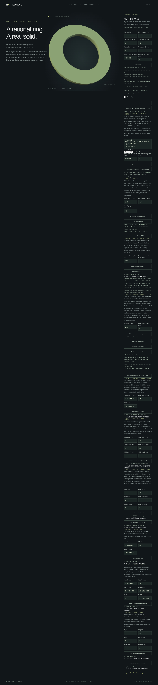

# Exact horizontal torus slabs



`NurbsTorusSolid::slab_between_local_z([lower, upper], policy)` retains the
material between two planes perpendicular to the source's represented axis.
The result is a `NurbsTorusHorizontalSlab`: an actual closed B-rep with original
rational wall restrictions and two planar annular caps. Bounds are local Z
coordinates in model length units. Rigid placement is preserved.

```rust
use hagane::{Frame3, GeometryTolerance, NurbsTorusSolid};

fn main() -> hagane::Result<()> {
    let policy = GeometryTolerance::new(1e-6, 1e-10, 0.0)?;
    let source = NurbsTorusSolid::new(Frame3::IDENTITY, [16.0, 4.0], policy)?;
    let slab = source.slab_between_local_z([-1.0, 1.5], policy)?;
    slab.validate(policy)?;
    let mesh = slab.tessellate(0.1, policy)?;
    let step = slab.export_step_mm(policy)?;
    println!("{} triangles; {} STEP bytes", mesh.triangles.len(), step.len());
    Ok(())
}
```

The meridian boundary has two retained wall chains: an outer path from lower to
upper and an inner path from upper to lower. Restrictions preserve the original
source surface parameter domains. Actual rational rim curves are shared with
the cap wires; plane pcurves project their actual coefficients without changing
their weights. Lower and upper caps face opposite directions. Every edge has
two opposing oriented uses. Annular faces contain inner wires, so topology
checks account for their holes rather than treating every face as a disk.
Meridian attachments use positive degree-one NURBS UV curves with explicit
original interval endpoints. This avoids an affine `a + (b-a)` endpoint rounding
one ULP outside a restricted surface, without clamping or loosening its domain.
Major-rim attachments retain their affine UVs; cap pcurves remain quadratic.

The source remains immutable. A slab is not produced by mesh CSG, union of
disconnected previews, or substitution of an analytic proxy for the retained
NURBS body. Its complete coefficient and topology certificate is checked before
success. `bounds` includes actual vertices, spatial edge controls, restricted
wall controls and plane-projected cap pcurve controls. This conservative
positive-weight hull covers the caps as well as the walls; it does not claim
tight analytic extrema.

Both finite bounds must lie strictly within `(-minor_radius, minor_radius)`,
with lower less than upper. Tip clearance, the physical separation of the planes,
partial strips, annular widths and world-coordinate precision must resolve the
original full-body tolerance and arithmetic reserves. Literal zero is allowed;
near-zero nonzero boundaries never snap to zero. Contacts, unresolved dimensions,
invalid/nonfinite inputs and insufficient display budgets return explicit errors.
Oblique slabs, imported slab STEP bodies, slab mass properties, slab line/ray queries and general torus Booleans remain unsupported.
[Slab point queries](nurbs-torus-slab-classification.md) classify the actual
retained walls and finite annular caps with checked face/UV witnesses.

The ideal cross-section area is `4*pi*R*sqrt(r*r-z*z)`; integrating between
the two retained heights gives the slab volume. Independent numerical quadrature
checks the analytic kernel result and does not supply modeling metrics.
With normalized bounds `a`, `b`, radial factors `ca`, `cb` and angle difference
`delta`, the dimensionless disk-band area is evaluated as the positive sum
`(delta - sin(delta)) + ((ca + cb)^2 + (a - b)^2)*sin(delta)/2`.
A small-angle series avoids subtractive cancellation in its first term;
physical height gaps resolve close bounds and radial factors near the tips.
Checked binary scaling rejects unrepresentable volumes without avoidable
intermediate overflow.

Display evaluates the actual B-rep with shared boundary samples. Wall chord
bounds follow the existing torus Hessian estimate with floating-point/frame/cache
reserves, and cap triangles reuse the actual inner and outer rims. Those reserves
are engineering bounds, not formal interval certificates. Exact STEP export
serializes the actual restricted surfaces, shared curves and both cap pcurves.
The shared dyadic grid stops at 32 subdivisions per quarter/strip, with at most
33,280 triangles for the supported four-strip maximum. An insufficient chord
or arithmetic budget fails explicitly.

`NurbsTorusDemoSession::slab_horizontal(lower, upper, chord)` completely serializes
the actual B-rep, display and STEP before accepting the new slab. Its separate
cache preserves the source and existing one-plane split pair. Rejected geometry
or display requests preserve all accepted bodies. Successful source edits and
STEP imports clear both derived caches. `accepted_slab` and its policy expose
the actual native body; `slab_step` returns a read-only report from that body.

The separate WASM `hagane_nurbs_torus_slab_begin/push/finish` transport accepts
exactly three finite values: lower height, upper height and display chord error.
Malformed input is latched and rejected. `hagane_nurbs_torus_slab_step` exports
the actual accepted slab without generating a new body or display.

Run `cargo run --locked --example nurbs_torus_horizontal_slab`. An optional JSON
array contains `[major, minor, rotation_y_radians, tx, ty, tz, linear, chord,
lower, upper, slab_chord]`. The existing [torus demo](nurbs-torus.md) can preview
and download a slab, then switch back to the source or previous split children.
Source probes continue to query the full source. Cut-child probes are disabled in
the slab preview; separate slab point controls use its actual accepted body.
[Slab finite segments](nurbs-torus-slab-segment.md) are implemented; slab line
and ray queries remain unsupported. Rejected operations
preserve the previous preview and export; a source section overlay remains
associated with the full source and can be shown over the slab.

Original implementation: MIT OR Apache-2.0. No new dependencies, OCCT source or
copied implementation are used. The rational geometry and torus references in
[references](references.md) apply.
