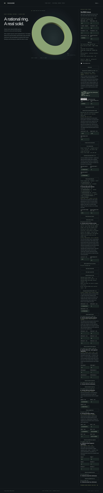

# Mesh-free torus slab point queries



`NurbsTorusHorizontalSlab::point_query(point, policy)` classifies a world-space
point against the actual accepted horizontal slab. It returns `Inside`, `Outside`
or `Boundary`; a boundary result includes its actual face index, original UV,
evaluated point, measured distance and outward unit normal. `classify_point`
returns only the location through the same checked operation.

```rust
use hagane::{Frame3, GeometryTolerance, NurbsTorusSolid, Point3, PointLocation};

fn main() -> hagane::Result<()> {
    let policy = GeometryTolerance::new(1e-6, 1e-10, 0.0)?;
    let source = NurbsTorusSolid::new(Frame3::IDENTITY, [16.0, 4.0], policy)?;
    let slab = source.slab_between_local_z([-1.0, 1.0], policy)?;
    assert_eq!(slab.classify_point(Point3::new(16.0, 0.0, 0.0), policy)?,
               PointLocation::Inside);
    let cap = slab.point_query(Point3::new(16.0, 0.0, 1.0), policy)?;
    assert_eq!(cap.location, PointLocation::Boundary);
    assert!(cap.boundary.is_some());
    Ok(())
}
```

The tolerance band uses the **original full torus** scale. The actual slab and
source query/frame/world precision are checked before outside shortcuts. Queries
do not use the display mesh or substitute the full source for the retained slab.
For example, material above the upper cap can be inside the source and outside
the slab; removed wall patches are not slab boundary witnesses.

Distance to the retained wall is measured in the radial/height meridian plane.
An unconstrained tube-circle foot is retained only when its height lies between
both cuts; otherwise the nearest of the four finite rim endpoints is used.
Both annular caps use the Euclidean distance
`hypot(radial_gap_to_annulus, height_gap)`. This prevents cap-hole and infinite
plane-extension witnesses, and preserves Euclidean tolerance at diagonal offsets.
The minimum finite boundary distance resolves the location before witness search.

Retained wall witnesses map the original source quarter/UV to its actual outer
or inner restricted wall face, then evaluate that face again. Cap witnesses
project onto the actual represented plane, solve its basis Gram system and
check the finite annulus, source material, other cap halfspace, outward normal
and measured world distance. Lower and upper caps have opposite outward normals.
Quarter patch seams preserve deterministic original UVs.

Physical trim rims and other unresolved cases return explicit errors. A rich
wall witness must clear both cut rims by ten full-body tolerance bands plus
arithmetic reserve; cap witnesses require strict annular clearance and resolved
source material. Ambiguous tolerance margins, nonfinite points, remote/world
precision failures and invalid shape/query policies are refused. No snapping,
mesh approximation or generic closest-point guarantee is introduced.
Arithmetic allowances are binary64 engineering guards, not formal interval
certificates. Native/WASM tests retain strict coordinate, UV and normal checks;
measured residuals are checked against each serialized point-pair norm and
cross-platform differences are limited by their actual coordinate displacement.

`NurbsTorusDemoSession::query_slab_point(point)` reads its accepted slab and
stored policy without changing source, split pair, slab, section or STEP exports.
The separate WASM `hagane_nurbs_torus_slab_point_begin/push/finish` transport
accepts exactly three finite world XYZ values and latches malformed input.
Successful source edits/imports invalidate the slab; rejected edits and queries
preserve accepted state.

Run `cargo run --locked --example nurbs_torus_slab_point`. An optional JSON array
contains the eleven slab-demo values followed by world XYZ:
`[major, minor, rotation_y_radians, tx, ty, tz, linear, chord, lower, upper,
slab_chord, x, y, z]`. In the [torus browser demo](nurbs-torus.md), the separate
slab point control is enabled only while viewing a privately accepted slab.
Failed queries preserve the previous result, geometry, camera and exports.

[Slab finite segments](nurbs-torus-slab-segment.md) are implemented. [Slab lines
and rays](nurbs-torus-slab-line.md) are implemented. Slab inertia and general
curved-body queries remain unsupported. Original implementation is MIT OR Apache-2.0;
no dependency, OCCT source or copied algorithm is introduced. See the elementary
Euclidean and rational-geometry derivations in [references](references.md).
