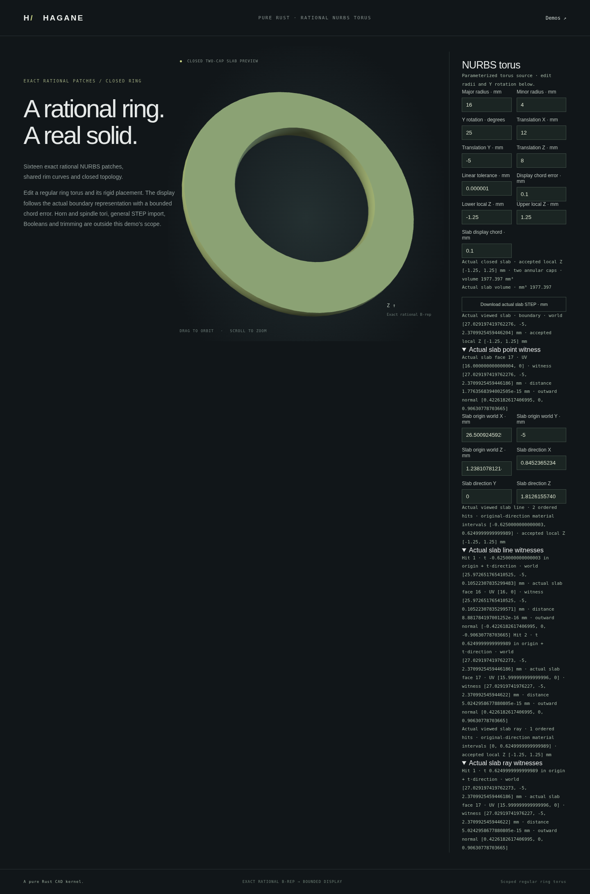

# Lines and rays through actual torus slabs



`NurbsTorusHorizontalSlab::intersect_line(origin, direction, policy)` queries an
infinite world line. `intersect_ray` queries its forward part. Both return
`NurbsTorusLineIntersection`: up to four ordered actual boundary hits and two
material intervals. Parameters refer to the original `origin + direction * t`;
directions need not have unit length. A ray uses `t >= 0` and clips an interval
to zero when its origin is strictly inside the actual retained material.

```rust
use hagane::*;

fn main() -> hagane::Result<()> {
    let policy = GeometryTolerance::new(1e-6, 1e-10, 0.)?;
    let source = NurbsTorusSolid::new(Frame3::IDENTITY, [16., 4.], policy)?;
    let slab = source.slab_between_local_z([-1., 1.], policy)?;
    let line = slab.intersect_line(
        Point3::new(16., 0., 0.), Vec3::new(0., 0., 2.), policy,
    )?;
    assert_eq!(line.hits.len(), 2);
    let ray = slab.intersect_ray(
        Point3::new(16., 0., 0.), Vec3::new(0., 0., 2.), policy,
    )?;
    assert_eq!(ray.material_intervals[0][0], 0.);
    assert_eq!(ray.hits.len(), 1);
    Ok(())
}
```

## Geometry and refusal conditions

A conservative local enclosure of the original full torus supplies a finite
supporting segment. The original anchor, direction, full-body policy and world
precision are checked before enclosure miss shortcuts. Both cropped endpoints
must be Outside the original source and the actual slab. The existing
[slab finite-segment solver](nurbs-torus-slab-segment.md) clips original source
intervals against both actual annular caps and preserves restricted-wall UVs.
No display mesh or surrogate CAD body supplies intersections.

Mapping to the original nonunit parameter checks physical reconstruction error
and reevaluates actual face UVs. Absolute physical root error and outward-normal
conditioning must resolve the linear policy. Material widths and separations
must remain physically resolved; parameters and intervals must stay ordered.
Ray origin classification must agree with an interval straddling zero, and
physical travel must agree with each retained parameter's sign.

Finite nonzero directions and finite origins are required. Boundary-band ray
origins, physical rims, cap-coincident material, tangencies, shallow/unresolved
crossings and arithmetic overflow or insufficient world precision return explicit
errors. Discarded-source contacts may conservatively refuse. An infinite line
can start on a resolved transverse boundary; this does not grant boundary-origin
ray support. The slab construction domain is unchanged.

Slab mass properties, oblique torus slabs, arbitrary curved-body queries and
general torus Booleans remain future work.

## Native, WASM and browser

Run `cargo run --locked --example nurbs_torus_slab_line`. Its optional JSON array
contains eighteen values:
`[major, minor, rotation_y_radians, tx, ty, tz, linear, chord, lower, upper,
slab_chord, origin_x, origin_y, origin_z, direction_x, direction_y, direction_z,
mode]`, where mode zero selects a line and one selects a ray.

`NurbsTorusDemoSession::intersect_slab_line` and `intersect_slab_ray` use the actual
cached slab and stored policy. WASM has a separate six-finite-value transport:
`hagane_nurbs_torus_slab_line_begin`, `_push`, `_finish(mode)`. JSON kinds are
`nurbs_torus_horizontal_slab_line` and `nurbs_torus_horizontal_slab_ray`, with
`mesh_free: true`.

The [torus browser demo](../web/nurbs-torus.html) enables separate probes only
while viewing its privately accepted slab. Line and ray results independently
show actual face/UV witnesses, normals and original material parameters. Queries
preserve accepted geometry, camera, point/segment probes, section overlays and
cached exact STEP. Rejection preserves previous results. Successful source/slab
replacement or leaving the slab view clears stale results.

Original implementation is MIT OR Apache-2.0. No new dependency or OCCT source
was introduced. The mathematical basis is parametric line enclosure, polynomial
torus intersection, halfspace clipping and rational-surface evaluation; see
[references](references.md) and [source line/ray queries](nurbs-torus-line.md).
