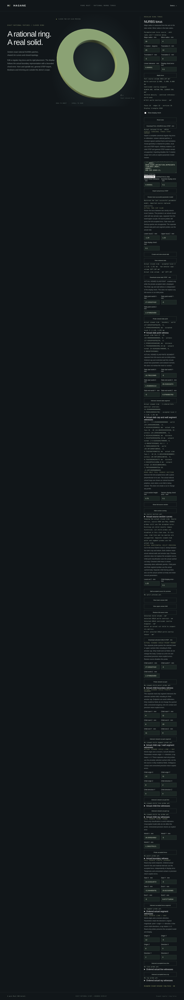

# Finite segments through actual torus slabs



`NurbsTorusHorizontalSlab::intersect_segment(start, end, policy)` returns mesh-free
intersections with the accepted rational B-rep. Parameters use
`start + (end - start) * t`, with `t` in `[0, 1]`. Results contain at most four
ordered boundary hits and two material intervals across the central hole.
An endpoint strictly inside material clips its interval to zero or one without
inventing a boundary hit. Reversing the segment reverses its parameters.

The original full-source quartic solver supplies material intervals. Both actual
annular cap halfspaces then clip those intervals. Cap hits must lie in finite
annular material and satisfy the other cap; plane extensions and cap holes do
not create hits. Retained wall hits preserve original source UVs and map them
into the actual restricted slab faces. Each witness contains actual face index,
UV, evaluated boundary point, measured residual and outward normal. No mesh CSG,
mesh intersection or surrogate shortened segment supplies CAD results.

```rust
use hagane::*;

let policy = GeometryTolerance::new(1e-6, 1e-10, 0.)?;
let source = NurbsTorusSolid::new(Frame3::IDENTITY, [16., 4.], policy)?;
let slab = source.slab_between_local_z([-1., 1.], policy)?;
let result = slab.intersect_segment(
    Point3::new(16., 0., -8.), Point3::new(16., 0., 8.), policy,
)?;
assert_eq!(result.hits.len(), 2);
Ok::<(), hagane::Error>(())
```

## Admission and explicit refusal

The slab must satisfy the bounded construction domain documented in
[horizontal slabs](nurbs-torus-horizontal-slab.md). Coordinates and endpoints
must be finite and distinct; dimensions, interval widths and root separations
must resolve the original full-body tolerance. Original source validation,
relative-tolerance and world-coordinate precision guards precede miss shortcuts.

Boundary-band endpoints, tangencies, cap-coincident material, physical trim-rim
contacts, shallow or unresolved crossings return explicit errors. Absolute
physical root error and normal conditioning are checked against the linear
policy, independently of the segment's length. Discarded-source contacts can
conservatively refuse even when their location is outside retained material.
This API does not promise arbitrary curved-solid intersections or a generic
closest-point solver. [Slab lines and rays](nurbs-torus-slab-line.md) are implemented.
Slab inertia, oblique slabs and general torus Booleans remain future work.

## Native, WASM and browser

Run `cargo run --locked --example nurbs_torus_slab_segment`. Its optional JSON
array contains seventeen values:
`[major, minor, rotation_y_radians, tx, ty, tz, linear, chord, lower, upper,
slab_chord, start_x, start_y, start_z, end_x, end_y, end_z]`.

`NurbsTorusDemoSession::intersect_slab_segment` uses the actual cached slab and
its accepted policy. WASM has a separate six-finite-value transport:
`hagane_nurbs_torus_slab_segment_begin`, `_push`, `_finish`. The JSON kind is
`nurbs_torus_horizontal_slab_segment`, with `mesh_free: true`.

The [torus browser demo](../web/nurbs-torus.html) enables the separate probe only
while viewing its privately accepted slab. Ordered hits show actual cap/wall
UVs and normals; material intervals retain original parameters. Queries preserve
geometry, camera, section overlays, other probes and exact cached STEP. Rejection
preserves the previous segment result. Leaving the slab view or accepting a new
source/slab clears stale segment results.

Original implementation is MIT OR Apache-2.0. No dependency or OCCT source was
introduced. The mathematical basis is polynomial torus intersection and convex
halfspace clipping, followed by rational-surface evaluation; see
[references](references.md) and [source segments](nurbs-torus-segment.md).
