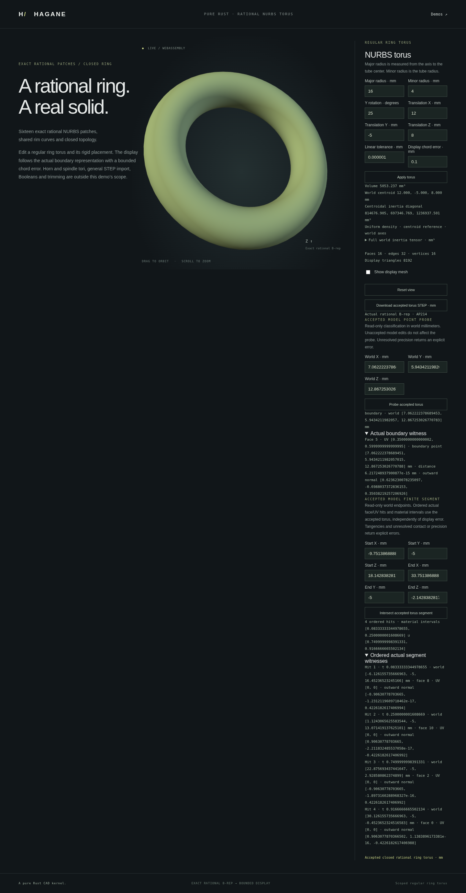

# Rational NURBS ring torus



```rust
use hagane::{Frame3, GeometryTolerance, NurbsTorusSolid};

fn main() -> hagane::Result<()> {
    let policy = GeometryTolerance::new(1e-6, 1e-10, 0.0)?;
    let torus = NurbsTorusSolid::new(Frame3::IDENTITY, [16.0, 4.0], policy)?;
    let mesh = torus.tessellate(0.1, policy)?;
    let step = torus.export_step_mm(policy)?;
    println!("{} triangles, {} STEP bytes", mesh.triangles.len(), step.len());
    Ok(())
}
```

Run `cargo run --example nurbs_torus` for the native JSON report, including the
actual B-rep, mesh, metrics and STEP. Build the shared browser kernel with
`./scripts/build-web.sh`, serve `web/` with
`python3 -m http.server 8000 --directory web`, and open
`http://localhost:8000/nurbs-torus.html`.
Edit radii or placement, drag to orbit, scroll to zoom, and download the accepted
solid's STEP. A rejected edit preserves the accepted geometry and export.
`npm run test:torus` runs the dedicated browser checks after the WASM build.

`NurbsTorusSolid::new(frame, [major_radius, minor_radius], policy)` constructs a
closed regular ring torus with sixteen degree-[2,2] rational tensor-product
patches, sixteen vertices and thirty-two shared quadratic edges. Positive
quarter-circle weights are retained in the actual BRep. `from_brep` checks the
complete canonical coefficients, topology and same-parameter face uses before
admitting an externally supplied body.

Both radii must be positive and resolved, with major radius strictly greater
than minor radius. Horn and spindle tori, unresolved tube/ring clearance,
unrepresentable world coordinates and malformed frames return explicit errors.
The tolerance policy includes the complete body's relative length scale.

`tessellate(chord_error, policy)` evaluates the retained surfaces and curves.
Every quarter uses one common dyadic grid of equal physical angular increments;
the rational quarter parameter is recovered from the half-angle tangent.
Retained edge samples and endpoint vertices are shared bit-for-bit across faces,
while each face evaluates its own normals. No analytic replacement mesh or
mesh Boolean is used.

For angular step h, the second partial derivative norms are bounded by R+r,
r and r. Barycentric angular variances and covariance are each at most h²/4;
the whole triangle interpolation remainder is therefore at most
h²(R+4r)/8 = (R+4r)π²/(32n²). This includes the mixed derivative, rather than
using an edge sagitta as a triangle bound. The implementation adds engineering
reserves for represented frame drift, rounded rational coefficients, inverse
parameter evaluation and canonical edge replacement. These are binary64
engineering bounds, not interval certificates. The grid stops at n=32 per
quarter, or 32,768 triangles. Invalid errors and requests beyond the arithmetic
or resource budget are refused.

Uniform-density metrics use V=2π²Rr², centroid at the retained frame origin,
and local centroidal inertia diag(V(R²/2+5r²/8), V(R²/2+5r²/8),
V(R²+3r²/4)). The tensor is rotated into world axes. Positive-factor binary
scaling avoids avoidable intermediate overflow; unresolved final metrics return
errors rather than zero values. `bounds(policy)` returns a conservative positive
rational control hull, rather than claiming a tight analytic AABB.

`export_step_mm(policy)` exports the actual rational BRep through the bounded
writer. Generic Solid NURBS operations and generic STEP import remain outside
this typed scope. Mesh-free [point queries](nurbs-torus-classification.md)
classify the accepted body and return actual face/UV boundary witnesses.
[Finite segment queries](nurbs-torus-segment.md) expose ordered actual face/UV
witnesses and up to two material intervals across the hole. The browser accepts
world start/end coordinates and reads the retained model; unaccepted edits and
failed queries preserve the accepted mesh and STEP.
Torus Boolean and line-query APIs remain unsupported.
